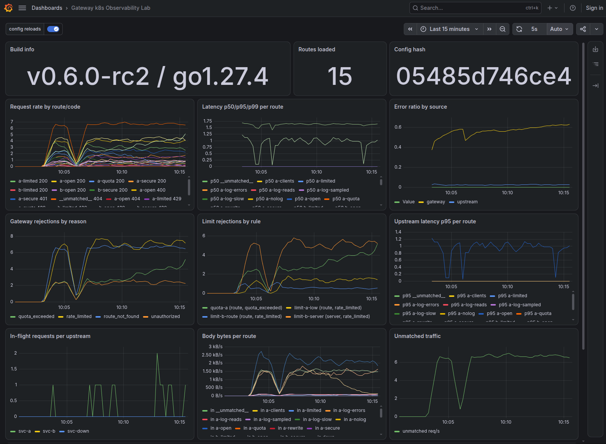

# k8s lab

A local k3d cluster running a published gateway image in front of two apps. Prometheus
scrapes it and Grafana shows it. The gateway loads `config/gateway.yaml`
directly; there's no dashboard/control plane.

| app | role | notes |
|---|---|---|
| `gateway` | 1 replica, `core` metrics | public `8080`, support `8081` (`/metrics`, `/healthz`, `/readyz`, token `lab-token`) |
| `httpbin` ([go-httpbin](https://github.com/mccutchen/go-httpbin)) | `svc-a`, plain HTTP | `/status/{code}`, `/delay/{300ms}`, `/unstable`, `/headers`, `/get` |
| `podinfo` ([podinfo](https://github.com/stefanprodan/podinfo)) | `svc-b`, TLS | cert issued by an in-cluster CA, verified by the gateway |
| [cert-manager](https://cert-manager.io) | TLS | self-signed root -> `lab-ca` issuer -> `podinfo-tls` secret (`manifests/certs.yaml`) |
| `prometheus` | scrapes the gateway pod | pod discovery, `pod`/`node` labels |
| `grafana` | anonymous admin | "Gateway k8s Observability Lab" dashboard, core metrics only (no stream, JWKS or dependency panels: the lab has no traffic for them) |

## Grafana dashboard sample


## Run

### **It Requires [k3d installed!](https://k3d.io/v5.9.0/)** 

```sh
up.sh                                   # create cluster + deploy (re-run to re-apply)
GW_IMAGE=nocleye/api-gateway:<tag> up.sh # another image
down.sh                                 # delete the cluster
```

| what | host URL |
|---|---|
| gateway | http://localhost:8501 |
| support | http://localhost:8581 |
| Prometheus | http://localhost:9590 |
| Grafana | http://localhost:3500 |

## Traffic

[Locust](https://locust.io) runs as a Job inside the cluster against the gateway
Service (`config/locustfile.py`, one User class per scenario) and prints its
summary when done. JWTs for the auth routes are signed with PyJWT using the
same keys as the gateway.

```sh
traffic.sh                                  # 20 users, 60s, all classes
traffic.sh -t 2m AuthUser RateLimitUser
traffic.sh -u 300 -r 100 -t 30s SteadyUser  # spike
```

Classes: `SteadyUser`, `ErrorsUser`, `RateLimitUser`, `AuthUser`, `ScannerUser`.

## Layout

- `config/`: gateway config, Prometheus config, Grafana provisioning and dashboard.
- `manifests/`: Deployments and Services.
- `kustomization.yaml`: ties both together. Config files become ConfigMaps, and a change rolls the affected pods on the next `up.sh`.
- `up.sh` installs cert-manager and creates the `gw-jwt` Secret (random HS256/HS512 keys) once.

The lab doesn't use any files from outside this folder.

Useful commands:

```sh
kubectl -n nocleye-obs get pods
kubectl -n nocleye-obs logs -f -l app=gateway --prefix
kubectl -n nocleye-obs rollout restart deployment/gateway   # watch /readyz and the drain
```
